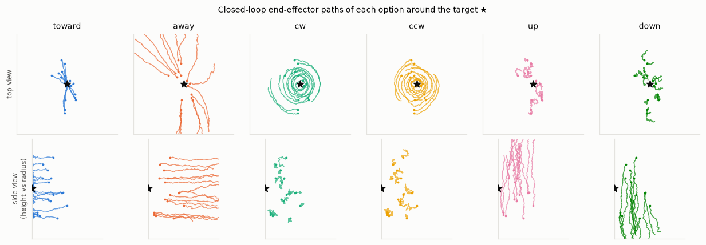
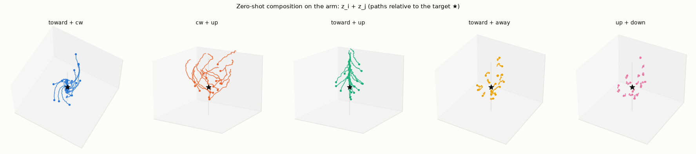
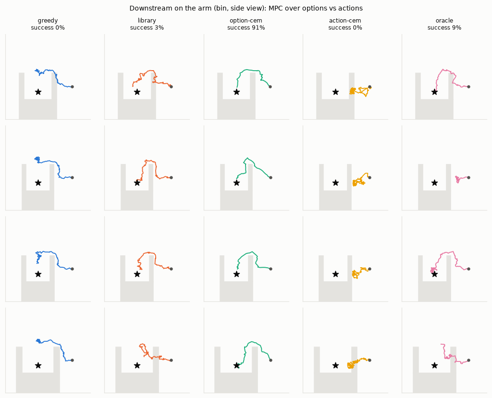

# JEM: energy-based option discovery and composition

From unlabelled demonstrations of several behaviours, JEM learns a space of **options**
with a single energy function E(s, z, a). That one function does three jobs:

- **recognize** which option a short snippet of behaviour shows;
- **execute** an option as a stochastic policy;
- **compose** options into new behaviour:
  - concurrently, by adding energies;
  - over time, by planning in option space.

There are two testbeds, with exact expert densities in both: a 2-D particle, and a
7-DoF Franka Panda arm simulated on the GPU with MuJoCo Warp.


## The idea

The energy is **linear in the option**:

E(s, z, a) = −τ ⟨z, φ(s, a)⟩, with unit-norm learned features φ.

So p(a | s, z) is an exponential family over actions whose natural parameter is the
option z. Four things follow:

- **Composition is vector addition.** E(z₁) + E(z₂) = E(z₁ + z₂): the product of
  two option policies is again an option. Weights act as temperatures, −z negates an
  option, and z = 0 is the uniform policy.
- **Recognition is a convex problem.** The option behind a context of N steps is
  the MAP of a strongly convex objective. It is a log-partition function plus a
  Gaussian prior, so it has a single optimum. Damped Newton finds it in a few
  iterations on cached features. Training gets exact implicit-function-theorem
  gradients through it for the price of one extra Newton step.
- **The energy scale cannot drift.** |E| ≤ τ‖z‖.
- **No sampler in the training loop.** The model infers the option from 8 steps and
  is scored, with InfoNCE against fixed uniform proposals (as in Implicit BC), on
  the next 8 held-out steps. Only behaviour that persists over time helps with that
  prediction, which is what turns z into an option.

A paper-style write-up, with the math, proofs and pseudo-code, is in
[`docs/paper.md`](docs/paper.md).

The method descends from Mordatch's *Concept Learning with Energy-Based Models* (2018)
and *Implicit Behavioral Cloning* (Florence et al., 2021). The repo is a 2026 PyTorch
rewrite of a 2022 JAX prototype (tag `legacy-jax-2022`). That prototype's algorithm is
available as the `legacy` preset.

## Testbed

A 2-D particle and a target. Four noisy scripted experts:

- move toward the target;
- move away from it;
- orbit clockwise;
- orbit counter-clockwise.

Each has heading noise of 0.5 rad, so one step is ambiguous, and its action density is
known in closed form. Every metric is therefore absolute: the true KL, the Bayes rate,
and the exact product of experts.

## Results

Default preset (`jem`), 10k steps, 3 seeds, about 6–7 minutes per run on a DGX Spark (GB10):

| | |
|---|---|
| Options rediscovered without labels (NMI of clustered z vs hidden expert) | 1.00 |
| Recognition accuracy from 1 / 2 / 4 / 8 steps (Bayes rate on the same snippets: 0.902 / 0.974 / 0.999 / 1.000) | 0.895 / 0.966 / 0.996 / 1.000 |
| Policy KL(expert ‖ option), nats | 0.05 |
| Zero-shot composition z_i + z_j vs the exact product of experts | 4.5° heading error |
| Weighted composition z_i + w z_j, w ∈ {¼, ½, 2, 4} | 5.1° heading error |
| Online tracking of hidden option switches (HMM over the library; Bayes 0.968) | 0.962 |
| Closed-loop agreement with the matched expert (experts' own value: 0.882) | 0.86 |

Early in training, the options organize into a 2-D compass in which opposite
behaviours are opposite vectors: cos(z_away, z_toward) ≈ −0.98 at 1k steps. Longer
training spreads them over more dimensions (−0.59 at 10k steps), trading that clean
geometry for a sharper fit.


**Composing over time.** The task is to reach the target around a concave obstacle that
no demonstration contained. Planning is MPC in the simulator, with 192 rollouts per
decision and a 40-step horizon, over 64 episodes × 3 seeds. Going straight for the
target gets trapped every time.

| Planner | Success |
|---|---|
| always "toward" | 0% |
| CEM over raw action sequences | 2% |
| CEM over the continuous option space | 46% |
| best of the discovered options and their pairwise sums | **85%** |


**Open problem: demonstrations that switch options mid-trajectory.** The switching-aware
objective (`objective.hazard`) recovers recognition well. At hazard 1/32, NMI goes from
0.85 to 0.96 and tracking from 0.77 to 0.91. Policy fidelity still lags the
non-switching case.

## A 7-DoF arm in MuJoCo Warp

A Franka Panda arm simulated on the GPU with [MuJoCo Warp](https://github.com/google-deepmind/mujoco_warp),
DeepMind and NVIDIA's MuJoCo on NVIDIA Warp (the physics solver inside Newton and Isaac
Lab). Thousands of arms step in parallel, driven straight from PyTorch tensors.

- **Actions:** 7-D joint velocity commands, tracked by the arm's position servos, with
  gravity compensated as on the real robot.
- **Experts:** six task-space behaviours around a target point. *toward* and *away*
  move radially, *cw* and *ccw* orbit the target's vertical axis, *up* and *down* move
  vertically. A damped-least-squares controller turns each into joint velocities, and
  every action is a truncated Gaussian around it, so every density, product of experts
  and Bayes rate is exact. One step is ambiguous; eight are nearly decisive.

What worked on the particle fails here: the options get *worse* the longer training runs,
while the training loss keeps improving. A separate option for every window absorbs
whatever persists in one demonstration (an orbit's radius), so the library entry shared
by all of an expert's demonstrations fits poorly. One change inside the framework fixes
it (`docs/paper.md` §3.9, §5.8):

- **Options consolidate into prototypes.** After 2k steps, six prototype options are
  trained as a mixture under the exact held-out likelihood. This is EM, with
  recognition as the E-step. A prototype must explain every demonstration assigned to
  it, so the features have to carry the state dependence. With this alone, the
  particle's recipe reaches the fidelity of a model trained with the expert labels.
- **Optional:** proposals from a learned behaviour prior raise the effective sample size
  in 7-D from 4% to 40%, using importance offsets so options keep their meaning. Targets
  drawn up to 2 s after the context help a little further. The `panda` preset uses both;
  on this arm they are refinements, not requirements.

Preset `panda`, 10k steps, 3 seeds:

| | |
|---|---|
| Options rediscovered (NMI) | 0.993 |
| Recognition from 1 / 2 / 4 / 8 / 16 steps (Bayes 0.803 / 0.892 / 0.963 / 0.987 / 0.998) | 0.788 / 0.886 / 0.951 / 0.975 / 0.994 |
| Policy KL(expert ‖ option), nats | 0.071 |
| Zero-shot composition z_i + z_j: KL to the exact product of experts | 0.154 nats (7.5°) |
| Weighted composition z_i + w z_j, w ∈ {¼, ½, 2, 4} | 0.134 nats (8.5°) |
| Online tracking of hidden switches (Bayes 0.948) | 0.943 |
| Closed-loop agreement with the matched expert (experts' own: 0.688) | 0.686 |




**Planning on the arm.** A physical obstacle, absent from every demonstration, stands
between the hand and the target: a pillar to go around, or a bin to reach into (up,
over the rim, down; plans are sequences of two options). All planners get 192 simulated
rollouts per decision; 64 episodes × 3 seeds:

| Planner | Pillar, 1 s horizon | Pillar, 2 s horizon | Bin, 2 s horizon |
|---|---|---|---|
| always "toward" | 7% | 8% | 0% |
| CEM over raw joint commands | 23% | 4% | 0% |
| discovered options and their sums | 46% | 43% | 6% |
| the same search with the true experts | 44% | 34% | 10% |
| CEM over the continuous option space | **65%** | **81%** | **85%** |

The discovered library plans as well as the true experts do. Searching the continuous
option space plans best, because it can blend behaviours for the final approach.



The arm model (`jem/envs/assets/panda.xml`) is a mesh-free version of the Panda in
[MuJoCo Menagerie](https://github.com/google-deepmind/mujoco_menagerie) (Apache-2.0;
license in `jem/envs/assets/LICENSE-menagerie`), with capsules fitted to its collision
meshes.

## Quickstart

```bash
uv sync --extra sim                       # PyTorch cu130 wheels for aarch64; sim = MuJoCo Warp
uv run jem train --preset jem             # the particle: writes runs/<timestamp>-jem/
uv run jem train --preset panda           # the arm (needs a CUDA GPU and the sim extra)
uv run jem dash                           # local dashboard: http://127.0.0.1:8765
```

A plain `uv sync` installs only what the particle needs.

More:

```bash
uv run jem presets                                    # jem, jem-em, ..., panda, panda-uniform, smoke
uv run jem train --preset jem --set model.option_dim=2 env.switch_prob=0.03 objective.hazard=0.03
uv run jem eval runs/<run_id> --figures out/          # re-evaluate a checkpoint
uv run jem downstream runs/<run_id> --task cup --horizon 40     # particle: circle | cup
uv run jem downstream runs/<run_id> --task bin --horizon 40     # arm: bin | pillar
uv run jem table                                      # markdown table of all runs (seeds pooled)
./experiments/phase1.sh                               # the experiment suites (phase1-4)
uv run pytest
```

Use options programmatically:

```python
from jem.options import OptionLibrary

lib = OptionLibrary.load("runs/<run_id>")
spiral = lib["toward"] + lib["cw"]  # an inward spiral nobody demonstrated
traj = lib.rollout(spiral, lib.world.reset(8), steps=60)
belief = lib.recognize(obs, act, hazard=1 / 16)  # online option posterior
```

Each run directory holds:

- `config.json` and `status.json`;
- an append-only `metrics.jsonl`;
- figures;
- the last checkpoint, including the discovered option library.

`jem dash` reads these files live: charts with smoothing, log scale, and divergence
markers; figures by step; config diffs. It runs locally, with no external services.

## Layout

| Path | Contents |
|---|---|
| `jem/energy.py` | Option-linear energy (factored or joint features); the 2022 concat-MLP energy |
| `jem/inference.py` | Newton option inference with implicit gradients; Langevin inference (2022) |
| `jem/objectives.py` | The JEM objective (plain, switching-aware, prototype mixture); the 2022 objective |
| `jem/prior.py` | The behaviour prior that proposes actions in high dimensions |
| `jem/envs/particle.py` | The 2-D particle world |
| `jem/envs/panda.py`, `jem/envs/assets/` | The Panda arm, its experts and obstacle tasks; a mesh-free Menagerie model |
| `jem/envs/mjw.py`, `jem/envs/kinematics.py` | Batched MuJoCo Warp stepping from torch; torch forward kinematics |
| `jem/envs/tgauss.py` | Truncated Gaussians: exact sampling, densities and products |
| `jem/evaluate.py`, `jem/figures.py` | Metrics against true expert densities; figures |
| `jem/downstream.py` | Obstacle tasks and MPC planners |
| `jem/options.py` | `OptionLibrary`: recognize, act, compose, roll out |
| `jem/dashboard/` | The local dashboard (stdlib server and one HTML page) |
| `experiments/` | Reproducible experiment suites |
