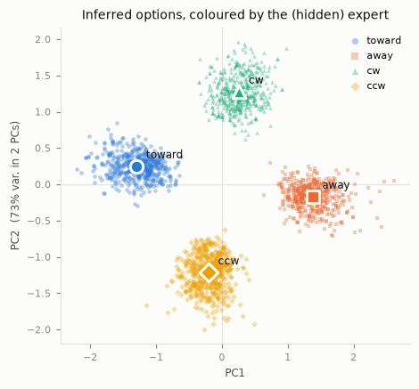
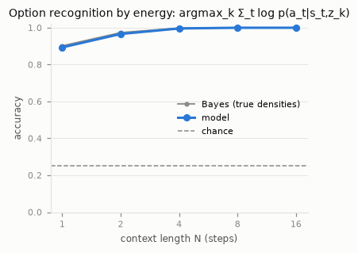
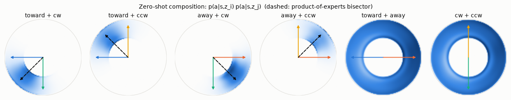
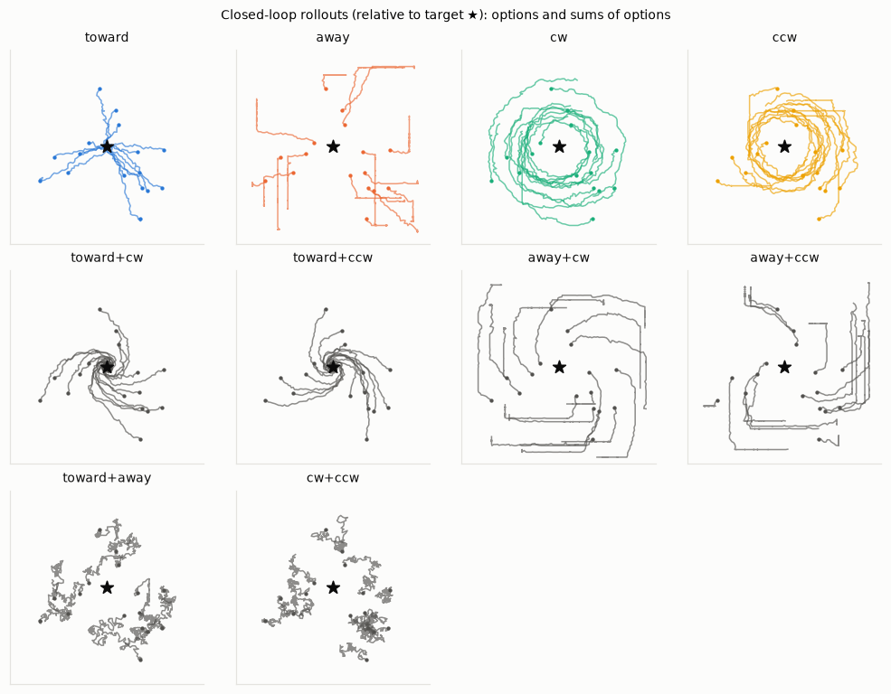
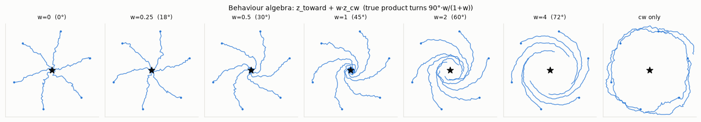
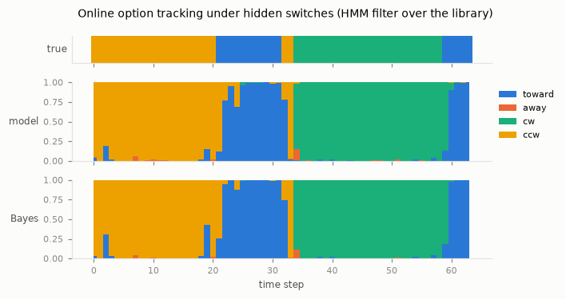
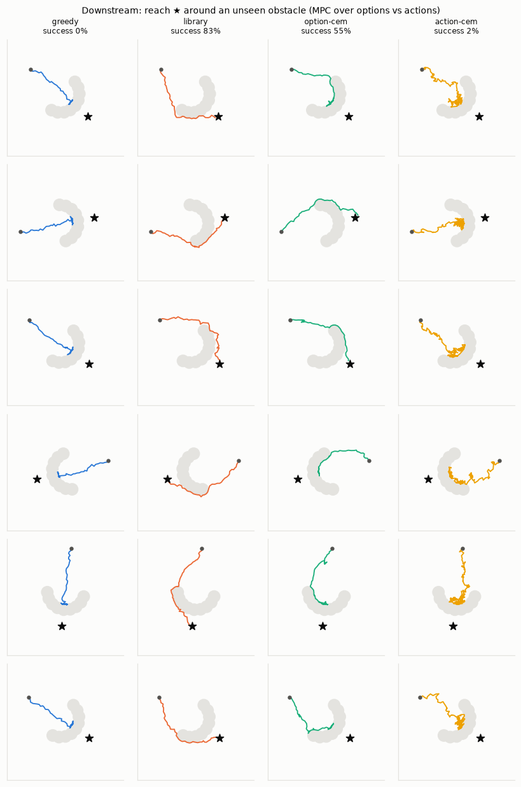

# Options as Natural Parameters

**Energy-based discovery, recognition and composition of behaviour**

Mahan Fathi · October 2026

---

> **Abstract.**
> One energy function over states, actions and a latent *option* should be able to:
>
> - discover reusable behaviours from unlabelled demonstrations;
> - recognize which behaviour a snippet of experience shows;
> - execute a behaviour as a policy;
> - compose behaviours into new ones.
>
> Energy-based concept learning promises all four. In practice it is undermined by
> unstable training: Langevin inference both over the latent and over the data, an
> unnormalized likelihood, and an energy scale nothing controls.
>
> We make the energy **linear in the option**,
> $`E_\theta(s,z,a) = -\beta\,\langle z, \phi_\theta(s,a)\rangle`$, with unit-norm learned
> features. The option then becomes the natural parameter of an exponential family over
> actions, and three structural facts follow:
>
> - adding options multiplies their policies, so composition is exact vector arithmetic;
> - inferring an option from a context is a strongly convex problem, which Newton's
>   method solves exactly, with exact implicit gradients for learning;
> - the energy scale is bounded by construction.
>
> Training needs no sampler in the loop. The option is inferred from part of a
> demonstration and scored on held-out later steps with a contrastive likelihood over
> fixed proposals. On a testbed where every expert density is known in closed form, the
> model:
>
> - rediscovers the hidden experts perfectly;
> - recognizes them within a point of the Bayes rate;
> - matches their policies to 0.05 nats;
> - composes them zero-shot to within 5° of the exact product of experts;
> - tracks hidden switches online at 99.5% of the Bayes-optimal filter's accuracy.
>
> Planning in the discovered option space solves an obstacle task, never demonstrated,
> 88% of the time, where planning over raw actions succeeds 2% of the time.

---

## 1 Introduction

Demonstrations of skilled behaviour rarely come labelled. A recording of an agent moving
toward a target, circling it, and backing away is a mixture of behaviours, each
persisting for a while before the next takes over. We want a model that turns such data
into *options* [Sutton et al., 1999]: temporally persistent behaviours that can be
recognized, executed, and recombined.

Energy-based models are an appealing substrate, because one function can serve every
role. Mordatch [2018] showed that a single energy $`E(x, w)`$ over data $`x`$ and a concept
code $`w`$ can recognize a concept, by minimizing over $`w`$, and generate it, by minimizing
over $`x`$. Implicit behavioural cloning [Florence et al., 2021] showed that policies
defined as minimizers of an energy over actions handle multimodal and discontinuous
behaviour gracefully. Composing concepts by adding energies is the textbook product of
experts [Hinton, 2002; Du et al., 2020].

Putting these together for behaviour, with $`E(s, z, a)`$ over state, option and action,
runs into the familiar instabilities of energy-based training:

- Langevin chains in both the latent and the action space, differentiated through;
- an unnormalized likelihood, under which ignoring the latent can be optimal;
- an energy scale that drifts until the samplers stop working.

We observe these failures directly in §5.5.

Our central observation is that one structural choice removes all three. Make the
energy linear in the option:

```math
E_\theta(s, z, a) \;=\; -\beta \,\big\langle z,\; \phi_\theta(s, a) \big\rangle,
\qquad \lVert \phi_\theta(s,a) \rVert_2 = 1 .
\tag{1}
```

Then $`\pi_\theta(a \mid s, z) \propto \exp(-E_\theta)`$ is an exponential family over
actions with sufficient statistics $`\phi_\theta`$ and natural parameter $`z`$. In
consequence:

1. **Composition is closed and exact.** Products of option policies are option
   policies, and their parameters add (Proposition 1).
2. **Recognition is convex.** The maximum a posteriori option behind a context is the
   unique minimizer of a strongly convex function, which Newton's method finds in a
   handful of iterations without re-evaluating the network (Proposition 2).
3. **The energy is bounded.** $`\lvert E \rvert \le \beta \lVert z \rVert`$, so the network
   cannot inflate energies to win the loss (Proposition 3).

On top of this structure we learn by **held-out prediction**: infer the option from a
context, score the later steps of the same demonstration. This is what makes the latent
an *option*, since only behaviour that persists helps predict the future. It is also a
proper scoring rule, so it calibrates the temperature $`\beta`$. Gradients through the
inferred option are exact and nearly free (Proposition 4). No sampler is ever run during
training.

**Contributions.**

- The option-linear energy, and its consequences for composition, inference and
  stability (§3.1–3.2).
- A sampler-free learning rule: held-out prediction with exact implicit gradients
  through convex recognition (§3.3–3.4).
- Two temporal extensions: hazard-aware learning when options switch, and online
  option tracking with an HMM over the discovered library (§3.6).
- An evaluation against *absolute* references (Bayes rates, true KL, exact products of
  experts), with an open-source implementation (§5).

---

## 2 Setting

**Data.** We observe unlabelled trajectories $`(s_1, a_1, \dots, s_T, a_T)`$ with actions
in a bounded set $`\mathcal{A} \subset \mathbb{R}^{d_a}`$ of volume $`\lvert\mathcal{A}\rvert`$.
Each trajectory is generated by one of several unknown behaviours. In §3.6 the behaviour
may also switch within a trajectory.

**Goal.** Learn $`\theta`$ and a space of options $`z \in \mathbb{R}^d`$ such that:

- every behaviour in the data corresponds to an option, and the corresponding policy
  $`\pi_\theta(a \mid s, z)`$ reproduces it;
- the option behind a snippet $`\big((s_t, a_t)\big)_{t=1}^{N}`$ can be inferred, and the
  inference sharpens as $`N`$ grows;
- simple operations on options yield sensible new behaviour: sums, weights, negation,
  and sequences.

**Notation.** $`\langle\cdot,\cdot\rangle`$ is the Euclidean inner product. $`\mathrm{sg}(\cdot)`$
is the stop-gradient operator. $`\operatorname{softmax}_k`$ normalizes over an index $`k`$.
$`\Lambda_\theta(s,z)`$ is a log-partition function.

---

## 3 Method

### 3.1 Option-linear energies

With the energy (1), the option policy and its log-partition function are

```math
\pi_\theta(a \mid s, z) = \exp\!\big(\beta \langle z, \phi_\theta(s,a)\rangle - \Lambda_\theta(s,z)\big),
\qquad
\Lambda_\theta(s,z) = \log \int_{\mathcal{A}} \exp\!\big(\beta \langle z, \phi_\theta(s,a)\rangle\big)\, da .
\tag{2}
```

There is deliberately no option-independent base energy. The option $`z = 0`$ is the
uniform policy, so the data can only be explained *through* $`z`$, and a latent that
carries no information is never optimal.

**Proposition 1 (composition).** For options $`z_1, \dots, z_n`$ and real weights
$`w_1, \dots, w_n`$,

```math
\prod_{i} \pi_\theta(a \mid s, z_i)^{\,w_i} \;\propto\; \pi_\theta\Big(a \;\Big|\; s, \textstyle\sum_i w_i z_i\Big).
\tag{3}
```

The product of experts of two options is the option $`z_1 + z_2`$. A weight acts as a
temperature. The negation $`-z`$ inverts a policy's preferences, and $`z = 0`$ is the
identity of the algebra.

**Proposition 2 (convex recognition).** For a context
$`C = \big((s_t, a_t)\big)_{t=1}^{N}`$ and a prior $`z \sim \mathcal{N}(0, \sigma^2 I)`$, the
negative log-posterior

```math
F_C(z) \;=\; \sum_{t=1}^{N} \Big[\Lambda_\theta(s_t, z) - \beta \langle z, \phi_\theta(s_t, a_t)\rangle\Big] + \frac{\lVert z \rVert^2}{2\sigma^2}
\tag{4}
```

is $`\sigma^{-2}`$-strongly convex, with

```math
\begin{aligned}
\nabla F_C(z) &= \sum_{t} \Big(\mathbb{E}_{\pi_\theta(\cdot\mid s_t, z)}\big[\beta\phi_\theta(s_t,\cdot)\big] - \beta\phi_\theta(s_t,a_t)\Big) + \frac{z}{\sigma^2},\\
\nabla^2 F_C(z) &= \sum_{t} \operatorname{Cov}_{\pi_\theta(\cdot\mid s_t, z)}\big[\beta\phi_\theta(s_t,\cdot)\big] + \frac{I}{\sigma^2}.
\end{aligned}
\tag{5}
```

So the recognized option $`\hat z(C) = \arg\min_z F_C(z)`$ exists and is unique. The
stationarity condition is *moment matching*: the option is the one whose expected
features equal the observed ones. The posterior is log-concave, and evidence accumulates
additively over steps. Recognizing a behaviour *is* composing the per-step energies over
time.

**Proposition 3 (bounded energy).** $`\lvert E_\theta(s,z,a) \rvert \le \beta\lVert z\rVert`$, hence

```math
\sup_{a}\, \log \pi_\theta(a \mid s,z) \;-\; \inf_{a}\, \log \pi_\theta(a \mid s,z) \;\le\; 2\beta \lVert z \rVert .
\tag{6}
```

The sharpness of every policy is controlled by the option's norm, which the prior
regularizes, and by a single scalar $`\beta`$. Unbounded features break this, and §5.4
shows what follows.

### 3.2 Recognition by Newton's method on cached features

**The estimator.** The integral in (2) is estimated with $`M`$ proposals
$`\tilde a_1, \dots, \tilde a_M`$ that cover $`\mathcal{A}`$ uniformly. We use a scrambled
Sobol set with a fresh random shift per batch [Cranley & Patterson, 1976], shared by
every state in the batch. Prepend the observed action as candidate $`k = 0`$ and define
the scaled candidate features

```math
U_{tk} = \beta\,\phi_\theta(s_t, a_{tk}) \in \mathbb{R}^d,
\qquad a_{t0} = a_t,\quad a_{tk} = \tilde a_k \;\; (k = 1, \dots, M).
\tag{7}
```

The surrogate objective is

```math
\hat F_C(z) = \sum_{t=1}^{N} \Big[\log \sum_{k=0}^{M} e^{\langle z, U_{tk}\rangle} - \langle z, U_{t0} \rangle\Big] + \frac{\lVert z\rVert^2}{2\sigma^2},
\tag{8}
```

a sum of log-sum-exps of affine functions plus a quadratic. It is therefore strongly
convex for *any* $`\theta`$ and *any* proposal draw, with gradient and Hessian given by (5)
once $`\pi`$ is replaced by the softmax over candidates,
$`\pi_{tk} = \operatorname{softmax}_k \langle z, U_{tk}\rangle`$.

**The solver.** We run damped Newton from $`z = 0`$, the no-preference option:
$`z \leftarrow z - \eta H^{-1} g`$. The step size $`\eta`$ is the largest value in
$`\lbrace 1, \tfrac12, \tfrac14, \tfrac18, \tfrac1{16}, 0\rbrace`$ whose objective is within
rounding error of the best. All candidates are evaluated in parallel.

- Taking the *largest* near-optimal step, rather than the strict argmin, matters near
  the optimum. There every candidate ties to machine precision, and a strict argmin
  stalls on $`\eta = 0`$.
- Each iteration costs $`O(NMd^2)`$ arithmetic on the cached $`U`$, with no network
  evaluations.
- Convergence is quadratic. Six iterations reach machine precision in float64 and a
  residual of about $`10^{-6}`$ in float32.

### 3.3 Learning by held-out prediction

**The objective.** A training window of $`L = N_c + N_t`$ consecutive steps is split into a
context $`C`$ (the first $`N_c`$ steps) and targets $`T`$ (the last $`N_t`$). The loss scores
the targets under the option recognized from the context:

```math
\mathcal{L}(\theta) \;=\; \mathbb{E}_{\text{windows}}\;\Bigg[-\frac{1}{N_t}\sum_{t \in T} \log \operatorname{softmax}_k \big\langle \hat z_\theta(C),\, U_{tk} \big\rangle \Big|_{k=0}\Bigg].
\tag{9}
```

This is the InfoNCE form [Gutmann & Hyvärinen, 2010; van den Oord et al., 2018] of
$`-\log \pi_\theta(a_t \mid s_t, \hat z)`$, using the same uniform counter-examples as
implicit behavioural cloning [Florence et al., 2021]. Three properties matter:

- **Persistence.** Because targets are *held out*, only information that persists across
  time helps. A latent that memorizes the context earns nothing, while one that captures
  the behaviour generating both halves does. This is how "option" enters the objective.
- **Calibration.** The loss is a proper scoring rule, so overconfident options are
  penalized. The temperature $`\beta`$ is learned and calibrated by it, which amounts to
  empirical Bayes for the prior scale, since $`\beta`$ and $`\sigma`$ are exchangeable.
- **No sampler.** Negatives come from a fixed proposal, never from the model, so there is
  no feedback loop between the energy and a sampler.

**Symmetric cross-fitting.** We also recognize from $`T`$ and score $`C`$, then average the
two losses. The features are shared, so this doubles the signal at little cost.

### 3.4 Exact gradients through recognition

The loss (9) depends on $`\theta`$ directly, through the target features, and indirectly,
through $`\hat z_\theta(C)`$. Since $`\hat z`$ is a stationary point of a strongly convex
function, the implicit function theorem gives
$`\mathrm{d}\hat z / \mathrm{d}\theta = -H^{-1} \, \partial_\theta \nabla_z \hat F_C`$, with
$`H = \nabla^2_z \hat F_C(\hat z)`$ a small $`d \times d`$ matrix. A single extra Newton step
realizes this exactly.

**Proposition 4 (one-step implicit gradient).** Let $`\bar z = \mathrm{sg}(\hat z)`$ and
$`\bar H = \mathrm{sg}\big(\nabla_z^2 \hat F_C(\bar z)\big)`$, and define

```math
\check z(\theta) \;=\; \bar z \;-\; \bar H^{-1}\, \nabla_z \hat F_C(\bar z;\, \theta).
\tag{10}
```

Then $`\check z = \hat z`$ in value, and
$`\partial \check z / \partial \theta = \mathrm{d}\hat z / \mathrm{d}\theta`$.

Backpropagation therefore never unrolls the solver. It needs one gradient evaluation at
the optimum and one $`d \times d`$ solve. Dropping the correction, $`\check z = \bar z`$,
gives an EM-style variant. §5.4 compares the two.

### 3.5 Acting, composing, and the option library

**Acting.** To act with option $`z`$ in state $`s`$, draw $`M`$ fresh proposals, weight them by
$`\exp\big(\beta\langle z, \phi_\theta(s, \tilde a_k)\rangle\big)`$, and resample
(sampling–importance–resampling). Composition uses the same procedure with
$`z = \sum_i w_i z_i`$, per (3).

**The library.** A library of discovered options is built without labels. Recognize
options on held-out windows, cluster them with $`k`$-means, and keep the centroids
$`z_1, \dots, z_K`$. These are the vectors one adds, weights, negates, and sequences.

### 3.6 Options that switch

**The problem.** When the behaviour may change at an unknown per-step hazard $`h`$, a
window can straddle a switch, and (9) then demands predicting targets from another
behaviour.

**Hazard-aware learning.** Two changes. First, each context step is weighted by the
probability that it shares the option of the context's edge,

```math
\hat F_C^{\,h}(z) = \sum_{t \in C} (1-h)^{\delta_t}\, \hat\ell_t(z) + \frac{\lVert z\rVert^2}{2\sigma^2},
\tag{11}
```

with $`\delta_t`$ the distance from the edge and $`\hat \ell_t`$ the per-step term of (8).
The problem remains strongly convex, and Proposition 4 still applies. Second, a target
at lag $`l`$ is scored by a two-component mixture. It shares the option with probability
$`\rho_l = (1-h)^l`$, and is otherwise an outlier at the uniform rate, $`1/(M{+}1)`$ in
InfoNCE units:

```math
-\log\Big(\rho_l\, \operatorname{softmax}_k \langle \hat z, U_{tk}\rangle\big|_{k=0} + (1-\rho_l)\,\tfrac{1}{M+1}\Big).
\tag{12}
```

**Online tracking.** Given the library, the posterior over the active option under
switching follows an HMM forward recursion with a closed-form transition step:

```math
b_t(k) \;\propto\; \pi_\theta(a_t \mid s_t, z_k)\,\Big[(1-h)\, b_{t-1}(k) + \tfrac{h}{K-1}\big(1 - b_{t-1}(k)\big)\Big].
\tag{13}
```

### 3.7 Planning in option space

**Sequential composition.** Options also compose *over time*. A model-predictive
controller selects, at each decision, the option (or sum of options) to run next:

- it simulates each candidate for $`H`$ steps;
- it scores each candidate by its distance to the goal;
- it executes the best candidate for $`R`$ steps, then replans.

Candidates come from either:

- the library and its pairwise sums, a discrete set of meaningful behaviours; or
- the cross-entropy method [Rubinstein, 1999] over $`z \in \mathbb{R}^d`$.

**Why plan over options.** The search dimension is $`d`$ regardless of the horizon. Over
raw action sequences it is $`d_a H`$.

### 3.8 Architecture

We factor the features through a state-dependent linear map of action features:

```math
\phi_\theta(s, a) = \frac{W_\theta(s)\, \psi_\theta(a)}{\big\lVert W_\theta(s)\, \psi_\theta(a) \big\rVert},
\qquad W_\theta(s) \in \mathbb{R}^{d \times p},\;\; \psi_\theta(a) \in \mathbb{R}^p .
\tag{14}
```

Both towers are MLPs. They run once per state and once per proposal and are joined by a
batched matrix product, so a batch with $`M`$ proposals costs two small forward passes
instead of one pass per (state, proposal) pair. The form is a rank-$`p`$ separable
approximation of a joint MLP on $`(s, a)`$, and it is linear in $`z`$ either way.

---

## 4 Algorithms

```text
Algorithm 1  RECOGNIZE(U, w, σ)
  input   U[t,k] ∈ ℝ^d   scaled candidate features, t = 1..N, k = 0..M (k = 0 observed)
          w[t] ≥ 0       step weights (1 unless hazard-aware)
  z ← 0
  repeat I times                                         ▷ I = 8 suffices
      π[t,k] ← softmax_k ⟨z, U[t,k]⟩
      μ[t]   ← Σ_k π[t,k] U[t,k]
      g ← Σ_t w[t] (μ[t] − U[t,0]) + z / σ²              ▷ moment-matching residual
      H ← Σ_t w[t] (Σ_k π[t,k] U[t,k] U[t,k]ᵀ − μ[t] μ[t]ᵀ) + I / σ²
      Δ ← H⁻¹ g
      η ← largest η ∈ {1, ½, ¼, ⅛, 1/16, 0} with F(z − ηΔ) ≤ min_η′ F(z − η′Δ) + ε
      z ← z − η Δ
  return z
```

```text
Algorithm 2  TRAINING STEP
  input   batch of windows (s_t, a_t), t = 1..N_c + N_t;  context C, targets T
  ã_1..ã_M ← shifted Sobol points on the action box    ▷ shared by the whole batch
  U[t,k]  ← β φ_θ(s_t, a_tk)                             ▷ one pass of each tower
  ẑ ← RECOGNIZE(sg(U_C), 1, σ)                           ▷ no gradient
  ž ← ẑ − sg(H)⁻¹ ∇_z F̂_C(ẑ; θ)                          ▷ Proposition 4
  ℓ ← −(1/N_t) Σ_{t∈T} log softmax_k ⟨ž, U[t,k]⟩ at k = 0
  repeat with C and T swapped; average                   ▷ symmetric cross-fitting
  θ ← θ − α ∇_θ ℓ
```

```text
Algorithm 3  TRACK(z_1..z_K, h, stream)                  ▷ online recognition under switching
  b(k) ← 1/K
  for each (s_t, a_t):
      b(k) ← π_θ(a_t | s_t, z_k) · [(1 − h) b(k) + h/(K − 1) · (1 − b(k))]
      b ← b / Σ_k b(k)
      emit argmax_k b(k)
```

```text
Algorithm 4  PLAN(s, goal; candidate source, H, R)       ▷ composing options over time
  while goal not reached:
      Z ← candidates: library ∪ pairwise sums, or CEM samples over z ∈ ℝ^d
      for z ∈ Z:  simulate H steps with a ~ π_θ(· | s, z);  c(z) ← min_h dist(s_h) + 0.1 dist(s_H)
      (CEM only) refit a Gaussian to the elite candidates and resample; repeat
      execute R steps with the best z
```

---

## 5 Experiments

### 5.1 Testbed and metrics

**Testbed.** A particle at position $`x \in [-1,1]^2`$ moves toward or around a fixed
target $`g`$, with velocity actions in $`[-1,1]^2`$. Four scripted experts steer at a fixed
angle relative to the bearing to the target:

| Expert | Angle | Behaviour |
|---|---|---|
| toward | 0° | moves to the target |
| away | 180° | moves away from it |
| cw | 90° | orbits clockwise |
| ccw | −90° | orbits counter-clockwise |

Each expert has Gaussian heading noise ($`\sigma = 0.5`$ rad) and uniform speed in
$`[0.5, 1]`$. A single step is therefore ambiguous: the Bayes-optimal one-step
recognition rate is $`2\Phi(\pi/2) - 1 = 0.884`$. Every expert density is known in closed
form, which makes every metric absolute:

- **Discovery:** normalized mutual information (NMI) between the clustered recognized
  options and the hidden expert identity.
- **Recognition:** accuracy of $`\arg\max_k \sum_t \log \pi_\theta(a_t \mid s_t, z_k)`$ on
  snippets whose start state is independent of the label, against the Bayes rule
  computed from the true densities on the same snippets.
- **Fidelity:** $`\mathrm{KL}(\text{expert} \,\Vert\, \text{option})`$, using the
  importance-sampled partition function.
- **Composition:** heading error of $`z_i + z_j`$ and of $`z_i + w z_j`$ against the *exact*
  product of the two true experts, pushed through the same estimator.
- **Tracking:** accuracy of the HMM filter (13) under hidden switches ($`h = 1/16`$),
  against the same filter run on the true densities.
- **Closed-loop agreement:** the mean cosine between executed actions and the matched
  expert's mean heading. The experts' own agreement is $`e^{-\sigma^2/2} = 0.882`$.

**Training setup.** 4,096 training trajectories of 64 steps, windows of 8 + 8 steps,
$`d = 8`$, $`M = 256`$, and 10k steps (about 6–7 minutes on one GB10). Appendix B lists the
full settings. Results are mean ± standard deviation over three seeds.

### 5.2 Discovery, recognition and fidelity

| Metric | Model | Reference |
|---|---|---|
| Discovery (NMI) | 0.999 ± 0.002 | 1 |
| Recognition, 1 step | 0.893 ± 0.002 | Bayes 0.902 |
| Recognition, 2 steps | 0.967 ± 0.001 | Bayes 0.974 |
| Recognition, 4 steps | 0.996 ± 0.000 | Bayes 0.999 |
| Recognition, 8 steps | 1.000 | Bayes 1.000 |
| Policy KL (nats) | 0.051 ± 0.006 | 0 |
| Closed-loop agreement | 0.858 ± 0.003 | experts 0.882 |
| Online tracking under switches | 0.963 ± 0.000 | Bayes filter 0.968 |

<p align="center">
  
  
</p>

*Left: recognized options, coloured by the hidden expert. Right: recognition accuracy
against the Bayes rate as evidence accumulates.*

The four experts are recovered as four clusters. Early in training they form a compass:
$`\cos(z_{\text{away}}, z_{\text{toward}}) = -0.988 \pm 0.003`$ after 1k steps, so opposite
behaviours are opposite vectors. Longer training spreads the options over more of the
eight dimensions (−0.62 ± 0.07 at 10k steps), and policy KL falls in the same period
from 0.59 to 0.05.

### 5.3 Composition

Adding two discovered options produces their product of experts *zero-shot*.

| Composition | Heading error vs the exact product of experts |
|---|---|
| Experts 90° apart: $`z_i + z_j`$ | 4.6 ± 0.1° |
| Weighted: $`z_i + w z_j`$, $`w \in \lbrace \tfrac14, \tfrac12, 2, 4\rbrace`$ | 4.8 ± 0.4° |

Sums of opposite experts lose their heading preference, as the product of opposite
von Mises-like policies should.

<p align="center">
  
</p>
<p align="center">
  
</p>
<p align="center">
  
</p>

*Top: action densities of summed options (dashed: product-of-experts bisector). Middle:
closed-loop rollouts. "toward + cw" is an inward spiral, while "toward + away" and
"cw + ccw" cancel into a random walk. Bottom: $`z_{\text{toward}} + w\, z_{\text{cw}}`$
sweeps continuously from approach to orbit.*

### 5.4 What matters

Ablations at 5k steps. Rows marked "3 seeds" report mean ± std; the others are a single
seed.

| Variant | NMI | KL | Heading | Composition | Agreement |
|---|---|---|---|---|---|
| Default, implicit gradient (3 seeds) | 1.00 | 0.038 ± 0.006 | 2.5 ± 0.4° | 3.1 ± 0.6° | 0.859 |
| EM: no gradient through $`\hat z`$ (3 seeds) | 1.00 | 0.060 ± 0.003 | 2.1 ± 0.7° | 4.0 ± 0.4° | 0.866 |
| Unbounded features | 0.80 | 0.648 | 15.8° | 24.0° | 0.751 |
| Two-dimensional options | 1.00 | 0.466 | 8.2° | 10.1° | 0.811 |
| Joint MLP features (6× slower) | 0.99 | 0.229 | 6.6° | 9.5° | 0.843 |

- **Bounded features are load-bearing.** Without the unit-norm constraint:
  - feature norms grow about tenfold;
  - the recognition problem becomes ill-conditioned, with the Newton residual up 300×;
  - the loss oscillates instead of falling.

  This is Proposition 3 failing in practice.
- **Two dimensions are too few.** With $`d = 2`$ the compass is enforced
  (cos −0.86) but fidelity suffers.
- **The factored architecture (14) wins** at equal steps over a joint MLP, and is six
  times faster.
- **Implicit gradient vs EM.** The exact implicit gradient fits the densities better
  (KL 0.038 vs 0.060). The EM variant is marginally better in closed loop, and it
  extrapolates options to states where they were never demonstrated somewhat better.
  Overall the two are close.

### 5.5 Comparison with Langevin-trained concept learning

We also train the formulation that motivated this work: concept learning in the style
of Mordatch [2018], applied to behaviour. It uses:

- an unnormalized energy $`E = f_\theta(s, z, a)^2`$;
- K-step Langevin inference over $`z`$ from the first transition of a window;
- K-step Langevin negatives over actions;
- a maximum-likelihood loss and KL losses differentiated through the chains.

| Configuration | NMI | KL | Heading | Agreement | Tracking |
|---|---|---|---|---|---|
| Short chains ($`K = 10`$, step $`5\cdot10^{-3}`$) | 0.001 | 2.95 | 88.6° | 0.03 | 0.31 |
| Long chains ($`K = 30`$, step $`0.1`$, $`d = 8`$) | 0.07 | 3.55 | 91.6° | 0.09 | 0.27 |

The two configurations fail in complementary ways:

- **Short chains barely move the latent.** The mean displacement of $`z`$ over a chain is
  0.18, against an initial norm of 0.8, so the inferred option is mostly its random
  initialization. Meanwhile the energy scale drifts by four orders of magnitude.
- **Long chains move it, then collapse the options.** The spread of inferred options
  across a batch falls from 0.99 to 0.11 within a few hundred steps. All options become
  identical (pairwise cosine +1), and without a prior the latent drifts to norm ≈ 22.

Neither configuration discovers the behaviours, so the instability is in the
formulation rather than in the hyperparameters.

### 5.6 Options that switch

Training data here switch behaviour with hazard $`h`$. Scores use a library built from
non-switching demonstrations, so they measure the model itself rather than library
contamination.

| Training data | Objective | NMI | Recognition, 8 steps | Tracking | Heading |
|---|---|---|---|---|---|
| switches, $`h = 1/32`$ | plain (9) | 0.85 | 0.83 | 0.77 | 32° |
| switches, $`h = 1/32`$ | hazard-aware (11–12) | **0.96** | **0.995** | **0.91** | **18°** |
| switches, $`h = 1/8`$ | plain (9) | 0.40 | 0.56 | 0.51 | 69° |
| switches, $`h = 1/8`$ | hazard-aware (11–12) | **0.71** | **0.83** | **0.74** | **34°** |

The hazard-aware objective recovers most of the recognition ability, but policy fidelity
still lags the non-switching case. We return to this in §7.

<p align="center">
  
</p>

*Online tracking (13) with the discovered library, compared with the same filter run on
the true densities.*

### 5.7 Planning with options

The task is to reach the target around an obstacle that never appeared in the
demonstrations. In the hardest variant the obstacle is a concave cup whose mouth faces
the agent, and heading straight for the target leads into the trap.

All planners share a budget of 192 simulated rollouts per decision, a horizon of
$`H = 40`$, and replanning every $`R = 5`$ steps. Results are over 64 episodes × 3 seeds.

| Planner (Algorithm 4) | Success |
|---|---|
| Always "toward" | 0% |
| CEM over raw action sequences ($`80`$ dimensions) | 1.6% |
| CEM over options ($`8`$ dimensions) | 47 ± 5% |
| Library and its pairwise sums ($`10`$ candidates) | **88 ± 2%** |

<p align="center">
  
</p>

On an easier obstacle (a single disc), every planner succeeds. The option planners reach
the target in about 45 steps, against 59–90 for raw actions. With a horizon of 20, no
planner escapes the cup, because a myopic cost cannot see the way out. The discrete
library beats CEM over $`z`$: its candidates are meaningful behaviours by construction,
whereas a Gaussian search over $`z`$ spends its budget on weak, low-norm options.

---

## 6 Related work

**Energy-based concepts and composition.** Mordatch [2018] introduced the
recognize-by-minimizing, generate-by-minimizing view that we adopt. Products of
experts [Hinton, 2002] and compositional energy-based generation [Du et al., 2020]
motivate composition by adding energies. Training such models with short-run MCMC
yields samplers rather than densities [Nijkamp et al., 2019]. It also needs care to stay
stable: energy regularization and spectral normalization [Du & Mordatch, 2019], and
entropy terms when differentiating through chains [Du et al., 2021]. We avoid samplers
during training altogether.

**Implicit policies.** Implicit behavioural cloning [Florence et al., 2021] trains energy
policies with InfoNCE against uniform counter-examples, our action-likelihood estimator.
Ta et al. [2022] analyse the gap between the theory and practice of such policies. Our
contribution is the latent option structure on top: linearity in $`z`$, convex
recognition, and held-out prediction.

**Option and skill discovery.** Options [Sutton et al., 1999] are commonly discovered by
segmenting demonstrations with latent-variable models:

- DDO [Fox et al., 2017] and CompILE [Kipf et al., 2019] segment demonstrations;
- OPAL [Ajay et al., 2021] learns offline latent primitives;
- unsupervised skill discovery maximizes mutual information [Eysenbach et al., 2019].

These methods use explicit, amortized posteriors and normalized decoders. Here,
recognition is exact convex inference in the same energy that acts, and composition is
algebraic.

**Implicit differentiation.** Differentiating through optimizers via the implicit
function theorem underlies OptNet [Amos & Kolter, 2017], implicit MAML
[Rajeswaran et al., 2019], and deep equilibrium models [Bai et al., 2019]. Our one-step
identity (Proposition 4) is the Newton analogue of Jacobian-free backpropagation
[Fung et al., 2022]. In our setting it is exact, because the inner problem is solved to
optimality.

**Exponential families.** The convexity of log-partition functions and moment matching
are classical [Wainwright & Jordan, 2008]. The novelty is treating the *option* as the
natural parameter of a learned family over actions. Grathwohl et al. [2020] read a
classifier's logits as a joint energy, a discrete special case of the same linear form.

---

## 7 Limitations and outlook

- **Switching within a context.** Hazard-aware learning (§3.6) down-weights the context
  but still infers a single option from it. The principled fix is to marginalize over
  the position of the last switch inside the context: solve (11) for every suffix,
  which is cheap on cached features, and weight each solution by its Laplace evidence.
- **High-dimensional actions.** Uniform proposals lose effective sample size
  exponentially in $`d_a`$. Two remedies keep the objective intact:
  - a learned proposal used purely as an importance sampler;
  - Langevin refinement of the proposals at test time.
- **An initiation model.** A learned prior $`p(z \mid s)`$ would say which options are
  plausible where. It would make joint inference of $`(z, a)`$ well posed, and it would
  supply a planning prior. Seeding option-space planning with the library is the
  immediate improvement suggested by §5.7.
- **Geometry vs fidelity.** The compass geometry, in which opposite behaviours are
  opposite vectors, is crisp early in training and relaxes as fidelity improves.
  Low-rank penalties on the library might keep both.

---

## References

- Ajay, A., Kumar, A., Agrawal, P., Levine, S., & Nachum, O. (2021). OPAL: Offline primitive discovery for accelerating offline reinforcement learning. *ICLR*.
- Amos, B., & Kolter, J. Z. (2017). OptNet: Differentiable optimization as a layer in neural networks. *ICML*.
- Bai, S., Kolter, J. Z., & Koltun, V. (2019). Deep equilibrium models. *NeurIPS*.
- Cranley, R., & Patterson, T. N. L. (1976). Randomization of number theoretic methods for multiple integration. *SIAM Journal on Numerical Analysis*.
- Du, Y., Li, S., & Mordatch, I. (2020). Compositional visual generation with energy based models. *NeurIPS*.
- Du, Y., Li, S., Tenenbaum, J., & Mordatch, I. (2021). Improved contrastive divergence training of energy-based models. *ICML*.
- Du, Y., & Mordatch, I. (2019). Implicit generation and modeling with energy based models. *NeurIPS*.
- Eysenbach, B., Gupta, A., Ibarz, J., & Levine, S. (2019). Diversity is all you need: Learning skills without a reward function. *ICLR*.
- Florence, P., Lynch, C., Zeng, A., Ramirez, O., Wahid, A., Downs, L., Wong, A., Lee, J., Mordatch, I., & Tompson, J. (2021). Implicit behavioral cloning. *CoRL*.
- Fox, R., Krishnan, S., Stoica, I., & Goldberg, K. (2017). Multi-level discovery of deep options. *arXiv:1703.08294*.
- Fung, S. W., Heaton, H., Li, Q., McKenzie, D., Osher, S., & Yin, W. (2022). JFB: Jacobian-free backpropagation for implicit networks. *AAAI*.
- Grathwohl, W., Wang, K.-C., Jacobsen, J.-H., Duvenaud, D., Norouzi, M., & Swersky, K. (2020). Your classifier is secretly an energy based model and you should treat it like one. *ICLR*.
- Gutmann, M., & Hyvärinen, A. (2010). Noise-contrastive estimation: A new estimation principle for unnormalized statistical models. *AISTATS*.
- Hinton, G. E. (2002). Training products of experts by minimizing contrastive divergence. *Neural Computation*.
- Kipf, T., Li, Y., Dai, H., Zambaldi, V., Sanchez-Gonzalez, A., Grefenstette, E., Kohli, P., & Battaglia, P. (2019). CompILE: Compositional imitation learning and execution. *ICML*.
- Mordatch, I. (2018). Concept learning with energy-based models. *arXiv:1811.02486*.
- Nijkamp, E., Hill, M., Zhu, S.-C., & Wu, Y. N. (2019). Learning non-convergent non-persistent short-run MCMC toward energy-based model. *NeurIPS*.
- Rajeswaran, A., Finn, C., Kakade, S., & Levine, S. (2019). Meta-learning with implicit gradients. *NeurIPS*.
- Rubinstein, R. (1999). The cross-entropy method for combinatorial and continuous optimization. *Methodology and Computing in Applied Probability*.
- Sutton, R. S., Precup, D., & Singh, S. (1999). Between MDPs and semi-MDPs: A framework for temporal abstraction in reinforcement learning. *Artificial Intelligence*.
- Ta, D. N., Cousineau, E., Zhao, H., & Feng, S. (2022). Conditional energy-based models for implicit policies: The gap between theory and practice. *arXiv:2207.05824*.
- van den Oord, A., Li, Y., & Vinyals, O. (2018). Representation learning with contrastive predictive coding. *arXiv:1807.03748*.
- Wainwright, M. J., & Jordan, M. I. (2008). Graphical models, exponential families, and variational inference. *Foundations and Trends in Machine Learning*.

---

## Appendix A — Proofs

**Proposition 1.**
$`\prod_i \pi(a \mid s, z_i)^{w_i} = \exp\big(\beta\langle \sum_i w_i z_i, \phi(s,a)\rangle - \sum_i w_i \Lambda(s, z_i)\big)`$.
The second term does not depend on $`a`$, so normalizing over $`\mathcal{A}`$ yields
$`\pi\big(a \mid s, \sum_i w_i z_i\big)`$. ∎

**Proposition 2.** Differentiating (2) under the integral gives the
exponential-family identities
$`\nabla_z \Lambda = \mathbb{E}_{\pi}[\beta\phi]`$ and
$`\nabla_z^2 \Lambda = \operatorname{Cov}_{\pi}[\beta\phi] \succeq 0`$.
Summing over steps and adding the prior's gradient $`z/\sigma^2`$ and Hessian
$`I/\sigma^2`$ gives (5) and $`\nabla^2 F_C \succeq \sigma^{-2} I`$. For the surrogate (8)
the same identities hold with $`\pi`$ replaced by the softmax over candidates. ∎

**Proposition 3.** By Cauchy–Schwarz,
$`\lvert \langle z, \phi \rangle \rvert \le \lVert z \rVert \lVert \phi \rVert = \lVert z \rVert`$,
so $`E`$ lies in $`[-\beta\lVert z\rVert, \beta\lVert z\rVert]`$. The log-density differences in
(6) are energy differences. ∎

**Proposition 4.** *Value:* $`\nabla_z \hat F_C(\bar z; \theta) = 0`$ at the optimum, so
$`\check z = \bar z = \hat z`$. *Gradient:* in (10), $`\bar z`$ and $`\bar H`$ are constants,
so $`\partial \check z/\partial\theta = -\bar H^{-1}\, \partial_\theta \nabla_z \hat F_C(\bar z; \theta)`$.
Differentiating the identity $`\nabla_z \hat F_C(\hat z(\theta); \theta) = 0`$ in $`\theta`$
gives $`H\, \mathrm{d}\hat z/\mathrm{d}\theta + \partial_\theta \nabla_z \hat F_C = 0`$, the
same expression. ∎

---

## Appendix B — Settings and compute

| Setting | Value |
|---|---|
| Option dimension $`d`$ | 8 |
| Feature towers | 3 hidden layers of 256 units, SiLU |
| Factorization rank $`p`$ | 64 |
| Feature normalization | unit sphere |
| Prior $`\sigma`$ | 1 |
| Initial $`\beta`$ | 5 (learned, log-parameterized) |
| Newton iterations | 8 |
| Line-search steps | $`\lbrace 1, \tfrac12, \tfrac14, \tfrac18, \tfrac1{16}, 0\rbrace`$ |
| Proposals (training / evaluation) | 256 / 4096, randomly shifted scrambled Sobol |
| Windows | 8 context + 8 target steps; batch of 256 windows; symmetric cross-fitting |
| Optimizer | AdamW, learning rate $`10^{-3}`$, 500 warm-up steps, cosine decay, gradient clip 1.0 |
| Training steps | 10k (main), 5k (ablations) |
| Data | 4,096 training and 512 validation trajectories of 64 steps |
| Throughput | ≈29 steps/s on one NVIDIA GB10 (TF32) |

The 10k-step runs of §5.2–5.3 were trained before two numerical refinements: the
tie-breaking line search of §3.2, and 8 rather than 10 Newton iterations. Together these
change recognized options by about $`10^{-4}`$ relative. All reported evaluations use the
final code.

Code, configurations and experiment scripts are in this repository:

- `experiments/phase1.sh`: §5.2–5.5;
- `experiments/phase2.sh`: §5.6;
- `experiments/phase3.sh`: §5.7.
